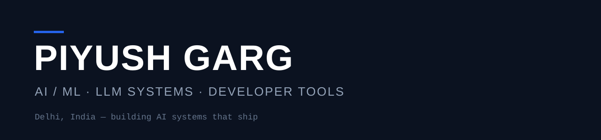
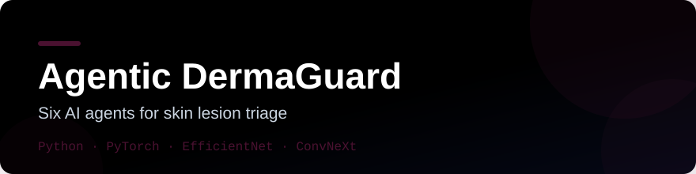

 

 

---

## `01` — What I Build

I work on **AI-powered applications, retrieval systems, and developer tools** — with an emphasis on turning experiments into usable software. Currently leading **Ekido** and the backend of **Vyana**.

- **AI / ML** — LLM applications, RAG pipelines, multi-agent systems, model evaluation
- **Backend & Infra** — APIs, databases, fault-tolerant job recovery, distributed training
- **Developer Tools** — debugging workflows, automation, practical tooling

## `02` — Selected Work

Trains small AI models on spare GPUs and pays only for verified work. When a GPU dies mid-run, the job resumes on another from the last trusted checkpoint (noticed in 0.6 s, 8 of 400 steps lost). Started as GPUChain — Top 8 at InfraShift Hackathon.     · [Live testnet ↗](https://ekido.duckdns.org)

 

Live healthcare platform for web and Android: prescriptions and reminders, lab reports in plain words, hospital tokens and an AI assistant that cites its sources, in English, Hindi and Hinglish.    · [Live site ↗](https://vyanahealth.app)

 

Ask questions about any PDF you upload — answers grounded strictly in the document, with source page citations. Hybrid BM25 + dense retrieval with a benchmark behind it.   · [Live ↗](https://doculens.duckdns.org)

 

Six-agent skin lesion screening and triage on HAM10000 (macro AUC 0.9782). 1st Runner Up, JAI Agentic Hackathon.  

 

A compact language model for automated software debugging and code repair, focused on Python.  

 

Reproducible experiments for running and optimizing open-weight LLMs on free GPU compute — GGUF, quantization, speculative decoding (+30.7% tok/s on a ~30B model), benchmarking.   

**Open source:** [useautumn/typescript#91](https://github.com/useautumn/typescript/pull/91) — worked example for the Autumn billing SDK (AI credits with rollovers).

## `03` — Technical Arsenal

### Languages

### AI / Backend / Infrastructure

### Web / Tooling

## `04` — GitHub Activity

 

---

**Less hype. More building.**

